# Section 1B: Security Testing, Event Management and a Secure AI-Assisted Development Lifecycle

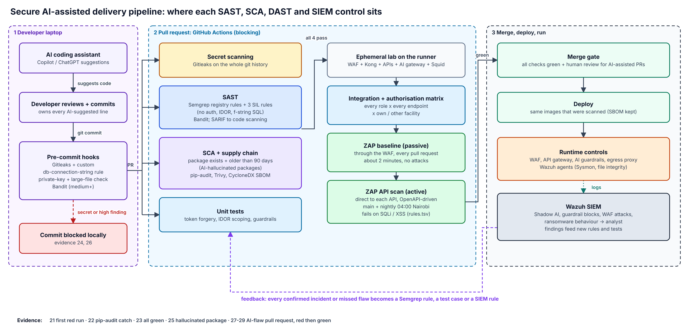

*Editable source: `docs/diagrams/pipeline.drawio`. Pipeline code: `.github/workflows/secure-pipeline.yml`.*

## 1. Deployment plan for SIEM, DAST and SAST

### Tool selection (all open source, all running in this repository)
| Need | Tool | Why this one | Where it runs |
| --- | --- | --- | --- |
| Secret scanning | **Gitleaks** v8.30.1 + custom `db-connection-string` rule | Fast, works in pre-commit and CI with one config file | Laptop (pre-commit), every PR (full history) |
| Static application security testing (SAST) | **Semgrep** (registry `p/python`, `p/owasp-top-ten`) + **3 SIL custom rules**; **Bandit** | Semgrep rules are short YAML, so the team can write rules for the flaws *we* see; Bandit covers Python-specific issues | Laptop (Bandit), every PR (both) |
| Software composition analysis (SCA) | **pip-audit**, **Trivy** (dependencies, Dockerfiles, compose, secrets), **CycloneDX SBOM**, **`check_packages_exist.py`** (my script) | pip-audit uses the Python advisory database; Trivy also checks infrastructure files; the custom script catches packages that do not exist (AI hallucinations) | Every PR |
| Dynamic application security testing (DAST) | **OWASP ZAP**: baseline (passive) and API scan (active, OpenAPI-driven) | Free, scriptable, understands OpenAPI, reads auth from an environment variable | Baseline every PR; active on `main` and nightly |
| Authorisation testing | **pytest** authorisation matrix | No scanner understands "facility 1 must not see facility 2" | Every PR and `main` |
| SIEM | **Wazuh** 4.14.9 (manager, indexer, dashboard) + agents with Sysmon | Open source, built-in JSON decoding, file integrity monitoring, MITRE ATT&CK mapping, active community | Runtime: all servers, endpoints, gateways, proxies |

### Integration points
| Where | What runs | Blocks? | Time |
| --- | --- | --- | --- |
| Developer laptop | Gitleaks, private-key check, Bandit (pre-commit) | Yes, the commit (screenshots 24, 26) | < 5 s |
| Every pull request | Secret scan, SAST, SCA, unit tests in parallel → ephemeral lab → integration + authorisation matrix → ZAP baseline | Yes, the merge (screenshot 27) | About 7 minutes |
| `main` and nightly (04:00 Nairobi) | Everything above + ZAP active API scans | Yes; opens a ticket | About 8–10 minutes |
| Runtime | WAF, Kong, AI gateway, Squid logs, endpoint agents → Wazuh | Alerts the analyst | Real time |

### Rollout (people matter more than tools)
1. **Weeks 1–2, observe.** Run everything in report-only mode on two pilot repositories. Collect false positives with the developers.
2. **Weeks 3–4, tune and block on the high-confidence findings only:**
   - secrets;
   - critical and high vulnerabilities with a fix available;
   - the custom rules;
   - SQL injection and cross-site scripting from ZAP.

   Everything else becomes a ticket.
3. **Month 2, extend** to all repositories with a shared reusable workflow. Agree the remediation deadlines:

   | Severity | Fix within |
   | --- | --- |
   | Critical | 7 days |
   | High | 30 days |
   | Medium | 90 days |
4. **Ongoing.** Hold a monthly review of false positives and exceptions. Every exception has an owner and an expiry date.

## 2. Pre-commit secret scanning and SCA for AI-hallucinated dependencies

### Secret scanning
- **Pre-commit** (`.pre-commit-config.yaml`): Gitleaks with the default rules plus a custom rule for exactly the case in the brief, a pasted database connection string (`.gitleaks.toml`). It also runs a private-key check, a large-file check, and Bandit at medium severity and above.
  - Screenshot 24: the commit of `DB = "postgresql://admin:…@db.prod.sil.local:5432/emr"` was blocked with rule `db-connection-string`.
- **CI**: Gitleaks again, over the **whole git history**, because pre-commit hooks can be skipped with `--no-verify`. I demonstrated exactly that in the planted-flaw pull request (screenshots 26–27): the local hook blocked the commit, I bypassed it, and the pipeline still stopped the code.
- **Real catch during this assessment:** the hook blocked my own evidence commit because a downloaded CI log contained bearer tokens (see 1A(d)).

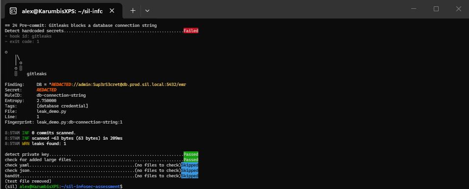

### Honest limit, and what covers it
Pre-commit protects the **repository**. It cannot stop someone pasting a credential into a Copilot or ChatGPT chat box. The controls for that are:

| Control | How it helps |
| --- | --- |
| No long-lived secrets on laptops | Developers use short-lived credentials from a secrets manager or single sign-on. There is little to paste, and what leaks expires |
| Copilot Business / Enterprise with content exclusions | Code and prompts are not used for training; sensitive files (`.env`, `secrets/`) are excluded from context |
| Egress proxy | Consumer AI is blocked and logged (rule 100101); the sanctioned tool goes through the AI guardrail gateway, which blocks secrets (`secret_detected`) |
| GitHub push protection + secret scanning | Second line if a secret reaches GitHub |
| Training + Duty to Report | Fast self-reporting means fast rotation (Section 2(f)) |
| Rotation runbook | Any exposed secret is rotated, not just deleted |

### SCA for hallucinated dependencies ("slopsquatting")
AI assistants sometimes suggest packages that do not exist. Attackers register those names and wait. A vulnerability scanner will not flag them because they have no known vulnerability. My script `scripts/check_packages_exist.py` fails the build when a dependency:
- **does not exist** on PyPI (screenshot 25: `fastapi-security-helpers-pro` → "does not exist on PyPI – possible AI-hallucinated package", exit code 1); or
- was **first published less than 90 days ago** and is not on the reviewed list `.approved-packages`.

It runs next to:
- **pip-audit** (known vulnerabilities, in strict mode);
- **Trivy** (dependencies, Dockerfiles and compose files, secrets; fails on high or critical);
- a **CycloneDX SBOM** kept with every build.

**Real catch:** on the first pipeline run (screenshot 21), pip-audit found **10 known vulnerabilities in `cryptography` 44.0.3** (screenshot 22). It was pulled in by LLM Guard, which pinned an old `presidio-anonymizer`. I removed the dependency rather than ignore the finding (1A(e)). The run was green afterwards (screenshot 23).

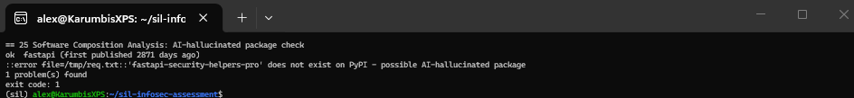

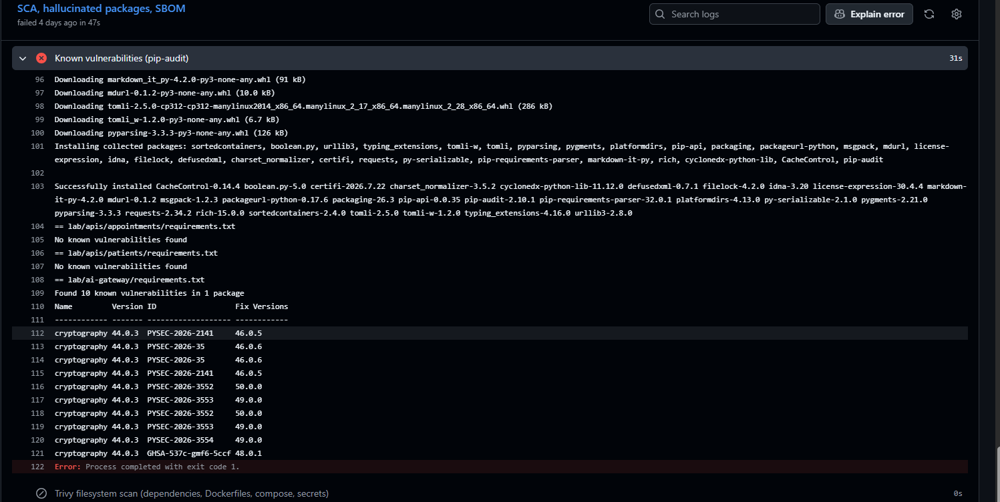

**Production additions:**
- a private package mirror (Artifactory or Nexus) with an allow-list;
- pinned hashes (`pip install --require-hashes`);
- Dependabot or Renovate for updates;
- the same existence and age check for npm.

## 3. SIEM: ransomware, Shadow AI, and onboarding a new log source

### Onboarding a new log source: the Squid egress proxy
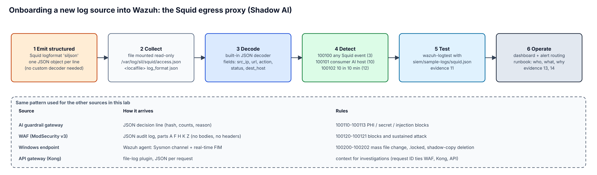

1. **Emit structured logs at the source.** I gave Squid a JSON log format (`siljson`), one object per line. Wazuh's built-in JSON decoder parses it, so no custom decoder is needed. That makes the source cheaper to maintain and less fragile.
2. **Collect.** The log folder is mounted read-only into the manager, and a `<localfile>` block with `log_format json` collects it (`siem/ossec-localfile.xml`). In production, a Wazuh agent on the proxy host does the same.
3. **Decode and verify the fields:** `src_ip`, `url`, `dest_host`, `action`, `status`.
4. **Write rules** in a dedicated range (100100–100202), with MITRE ATT&CK tags (`siem/rules/local_rules.xml`).
5. **Test before deploying** with `wazuh-logtest` and sample lines (`siem/sample-logs/`). Screenshot 11 shows Phase 2 decoding and Phase 3 rule 100101 firing.

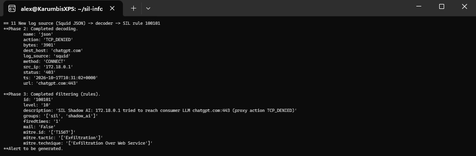
6. **Operate:**
   - alert routing;
   - a short runbook per rule;
   - a "silent source" check: alert when a source sends nothing for an hour.

### Detections built and proven
| Rule | Level | Detects | ATT&CK | Times fired | Evidence |
| --- | --- | --- | --- | --- | --- |
| 100101 | 10 | Request to a consumer AI site (ChatGPT, Claude, Gemini, Copilot, Perplexity, DeepSeek, Poe) at the proxy | T1567 | 11 | 11, 13 |
| 100102 | 12 | 10 or more such attempts from one source in 10 minutes (persistent Shadow AI use, not a stray click) | T1567 | 1 | 14 |
| 100111 | 12 | AI gateway blocked PHI or a secret | — | 3 | 13 |
| 100112 / 100113 | 10 / 12 | Prompt injection blocked / 5 attempts by one user in 5 minutes | — | 7 / 1 | 15 |
| 100120 / 100121 | 5 / 10 | WAF block / 20 blocks from one client in 2 minutes | T1190 | 28 / 1 | 13, 16 |
| 100200 | 12 | 25 or more file changes in 60 seconds on a monitored share (mass encryption behaviour) | T1486 | 7 | 17 |
| 100201 | 12 | File renamed to `.locked`, `.encrypted`, `.crypt` or `.enc` | T1486 | 57 | 18 |
| 100202 | 14 | Shadow-copy or backup deletion command (`vssadmin delete shadows`, `wmic shadowcopy delete`, `bcdedit … recoveryenabled no`, `wbadmin delete catalog`) via Sysmon process creation | T1490 | 4 | 19 |

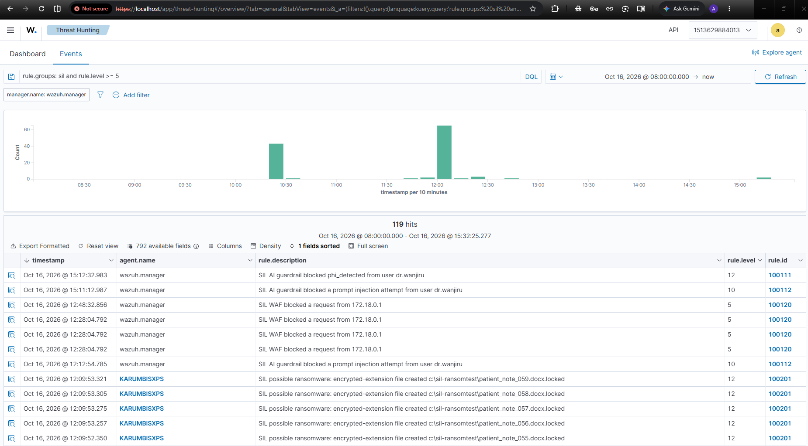

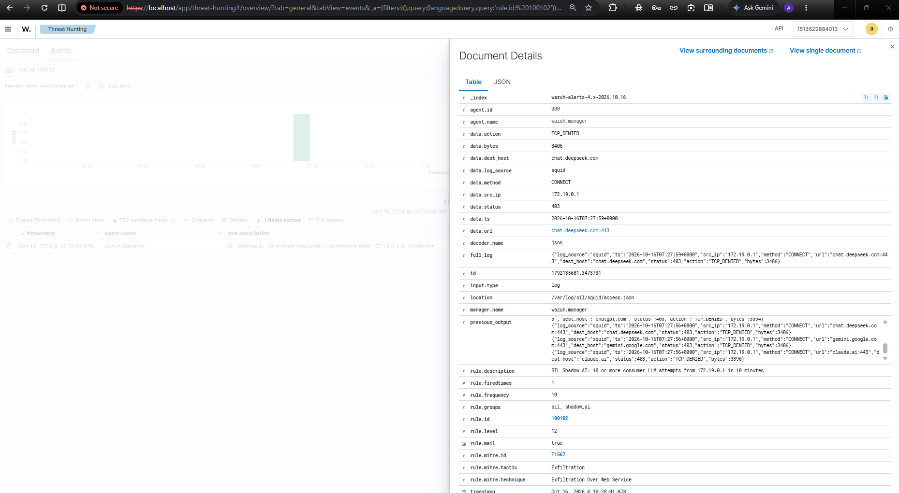

All 12 rules fired during testing; screenshot 20 counts every alert across the daily alert files.

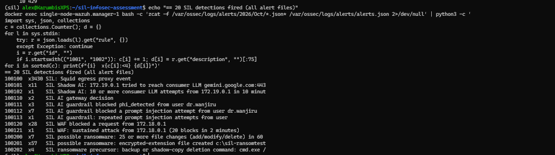

### Ransomware simulation
`scripts/simulate_ransomware.py` is harmless:
1. creates 60 dummy files in `C:\SIL-RansomTest`;
2. overwrites and renames them to `.locked`;
3. drops a ransom note;
4. *echoes* (does not run) `vssadmin delete shadows`.

**Sequence of alerts:**
- 100202 fired on the command line, with the parent process (`python.exe … simulate_ransomware.py`) visible in the Sysmon fields (screenshot 19).
- 100201 fired for each `.locked` file.
- 100200 fired seven times on the burst of changes.

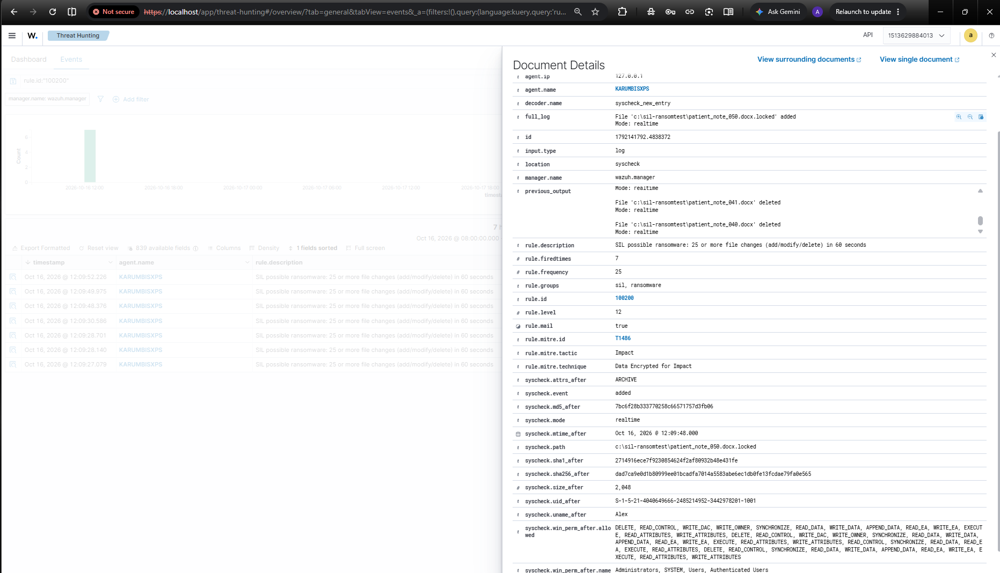

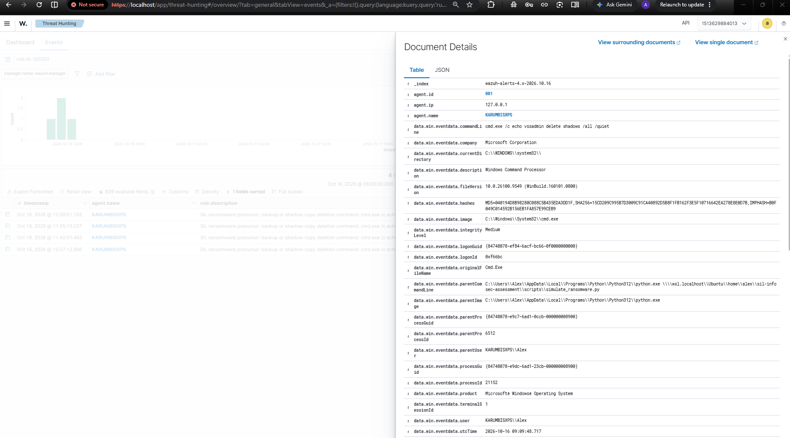

**Lessons from making these rules work** (each a real fix, documented in the commit history):
- Windows reports a rename as delete + add (events 553/554), not "modified". My first rule watched the wrong event and caught nothing.
- The file path field in Wazuh rules is `file`, not `syscheck.path`.
- Wazuh treats `url`, `user` and `srcip` as static fields that need their own tags, not `<field>`. The rules silently failed to load until I fixed this.

In production I would add:
- canary files in each share (any change = alert);
- active response to isolate the host;
- tests of backup immutability.

### Shadow AI simulation
`scripts/simulate_shadow_ai.ps1` sends 12 requests to four consumer AI sites (ChatGPT, Claude, Gemini, DeepSeek) through the proxy, as a user's browser would. Squid denied each one and logged it, rule 100101 fired per attempt, and 100102 fired once the threshold was passed (screenshot 14: `chat.deepseek.com`, `gemini.google.com`, `claude.ai` and `chatgpt.com` from one source).

**The response is educational first.** The alert goes to the analyst, who contacts the user, explains the sanctioned tool and records the outcome. Repeated or data-bearing attempts escalate (Section 2(g)).

## 4. Handling incomplete logs during an investigation

**My approach: treat the gap itself as evidence, and say how confident I am.**

1. **Preserve what exists first:**
   - export and hash the logs;
   - extend retention on the affected sources;
   - snapshot affected hosts before anything rotates.
2. **Map the gap precisely:** which sources, which hosts, which time window. Then establish why. A crashed agent, a full disk, a rotation policy, a misconfiguration or an attacker clearing logs (Windows event 1102, Sysmon stopped) all mean different things.
3. **Corroborate from other sources.** A missing endpoint log can often be rebuilt from:
   - the WAF, gateway and proxy logs;
   - DNS and firewall flows;
   - identity provider sign-ins;
   - cloud audit trails (CloudTrail, Azure Activity);
   - database audit logs;
   - email gateway logs.

   The request ID that Kong adds lets me join WAF, gateway and API records for the same request.
4. **Use host artefacts:**
   - the Windows registry, Prefetch, Amcache and the NTFS `$MFT` and `$UsnJrnl` journals;
   - browser history;
   - Linux shell histories and `journalctl`;
   - memory if the host is still running.
5. **State confidence explicitly** in the report. For example: "High confidence data was not exfiltrated via the proxy (complete proxy logs); low confidence for 14:00–14:40 on host X (agent offline)." I don't fill gaps with assumptions.
6. **Fix the cause and monitor for it:**
   - "silent source" alerts;
   - agent health dashboards;
   - log volume baselines;
   - forwarding logs off the host quickly so an attacker cannot erase them.

**A real example from this lab:**
- Rule 100121 (sustained WAF attack) **fired on the manager but never appeared in the dashboard.**
- The alert was 45,718 bytes. The field holding the 20 triggering events (`previous_output`) was **38,455 bytes**, larger than the index's 32,766-byte limit for one text field, so the indexer rejected the whole alert (screenshot 16).
- An analyst watching only the dashboard would have missed a sustained attack. I proved the detection worked from the manager's own `alerts.json`.

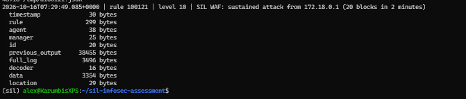

- The fixes are to:
  - trim WAF events before indexing (keep client, rule ID, URI and status);
  - alert on rejected documents;
  - regularly reconcile the rules fired on the manager against the alerts in the index.

## 5. Compliance reporting in a multi-cloud environment

1. **One control framework, mapped many ways.**
   - I would use **ISO/IEC 27001:2022 Annex A** as the master list.
   - Each control is mapped once to the **Kenya Data Protection Act 2019** and its 2021 regulations (the baseline), and to **HIPAA** and **GDPR** where a client or data subject needs them.
   - Also the **Digital Health Act 2023** where it applies.
   - One test then serves several frameworks.
2. **Collect posture data automatically from every cloud, in the same format:**

   | Source | Examples |
   | --- | --- |
   | Native tools | AWS Security Hub and Config, Microsoft Defender for Cloud and Azure Policy, Google Security Command Center |
   | Cross-cloud checks | **Prowler** (open source; one tool, one output format, CIS and ISO mappings) |
   | Kubernetes | Kubescape or kube-bench |
   | Pipeline | The scanner results and SBOMs from Section 1B, kept as build artefacts |
3. **Normalise into one evidence store**: for example, an S3 bucket with object lock, or a Wazuh or OpenSearch index. Every finding carries the cloud, account, resource, control ID, owner and timestamp.
4. **Report by audience:**
   - **Engineers:** live findings with fixes, in their own tools.
   - **Management:** a monthly one-page trend of compliant controls per framework, the top five risks and overdue remediation.
   - **Auditors:** an evidence pack per control, with a narrative, the automated evidence and the exceptions with approvals.
5. **Watch the multi-cloud specifics:**
   - **Data residency:** a map of which personal data lives in which region and provider, checked against cross-border transfer rules (DPA sections 48–50) and any localisation requirement.
   - **Shared-responsibility matrices** per provider.
   - **Consistent identity:** single sign-on everywhere and no local admin accounts.
   - **Consistent tagging** (data classification, owner), so reports group correctly.
   - **Provider attestations** (SOC 2, ISO certificates) collected yearly into the third-party register.

## 6. DAST in CI/CD, report interpretation, and catching AI logic flaws

### Integration with minimal impact
Two DAST modes, chosen to keep pull requests fast and still test the code deeply:
- **Every pull request: ZAP baseline through the WAF and gateway.**
  - It is passive: it sends no attacks and takes about 2 minutes.
  - It tests the shield: headers, cookies, information leaks.
  - It authenticates with a real token through `ZAP_AUTH_HEADER_VALUE`, so it sees the authenticated API rather than just the 401 page.
- **`main` and nightly: ZAP active API scan straight at each service on the internal network**, driven by the OpenAPI definition. It goes direct because:
  - Kong's 60/minute rate limit would throttle the scanner;
  - the WAF would hide whether the **code itself** is injectable.

  The baseline tests the shield; this tests the code.
- **Ephemeral target:** the lab is built fresh on the runner for each run and destroyed afterwards, so no shared test environment is polluted. The scan never touches production.
- **Policy as code** (`.zap/rules.tsv`):
  - SQL injection (40018) and reflected cross-site scripting (40012) **always fail** the build.
  - Three documented, reviewed exceptions are ignored: HSTS is set at the TLS edge, and `no-store` caching is intentional for patient data.

### Reading a ZAP report
For each alert I ask five questions:
1. What is the **risk** and the **confidence**?
2. Is the **evidence** real (the exact request and response)?
3. Is the endpoint **reachable** in production through the WAF?
4. What is the **CWE**?
5. What is the **decision**: fix, accept with an owner and expiry, or mark as a false positive with a reason?

**What the last pipeline run reported, and what I decided:**

| Scan | ZAP alert (plugin) | Risk (confidence) | Count | My reading | Decision |
| --- | --- | --- | --- | --- | --- |
| Patients API, active | Server Error response (100000), CWE-388 | Low (High) | 1 | One fuzzed request made the API return **500**. That is unhandled input reaching the database layer. A 500 can leak stack details and signals a validation gap even when nothing is exploitable | **Fix.** Reproduce from the request in the report, add input validation and a handler that returns 400/404, and add the request as a regression test |
| Patients API, active | Cross Site Scripting Weakness, persistent in JSON (40014), CWE-79 | Low (Low) | 2 | ZAP stored a script string in a patient name via `POST` and saw it returned in JSON. The API returns `application/json`, so it is not executable here, but any web front end that renders the name without encoding would be vulnerable | **Fix (defence in depth).** Allow-list characters in names (letters, spaces, hyphens, apostrophes); front-end output encoding stays mandatory |
| Patients + Appointments APIs, active | X-Content-Type-Options Header Missing (10021), CWE-693 | Low (Medium) | 3 + 2 | Correct for the services *on their own*. Kong adds the header for every client, which is why the baseline scan through the gateway did **not** report it. Comparing the two scans shows exactly which controls live at the gateway | **Fix cheaply.** Add the header in the shared API code as well, so a misrouted request is still protected |
| Both APIs, active | Client Error responses (100000) | Informational | 123 + 129 | Expected: ZAP fuzzes inputs and the APIs correctly answer 400/401/403/404/422 | **No action.** Shows validation working |
| Patients API, active | User Agent Fuzzer (10104) | Informational | 5 | Responses did not change by user agent | **No action** |
| Baseline through the WAF | Non-Storable Content (10049), CWE-524 | Informational | 5 | `Cache-Control: no-store` is deliberate for patient data | **Accepted by design** (documented in `.zap/rules.tsv`) |

**Overall reading:**
- No high or medium findings.
- SQL injection and cross-site scripting rules found nothing executable.
- The one real defect is the 500 response.
- The gap between the direct and the gateway scans confirms the layered design works, and shows where the services rely on the gateway.

### Adapting SAST and DAST to subtle AI-generated logic flaws
Scanners find *syntax-shaped* bugs (injection, unsafe functions). AI assistants mostly introduce *logic* bugs: code that works, looks clean and is missing a check. Typical examples:
- a lookup by ID without an ownership check;
- a new route without an authentication dependency;
- a "temporary" export endpoint;
- a trust-the-client field;
- a hallucinated package.

My strategy adds five things:

| Technique | In this repository |
| --- | --- |
| **Custom SAST rules for our own patterns** | `.semgrep/sil-rules.yml`: `fastapi-route-without-auth`, `select-by-id-without-facility-scope`, `sql-built-with-fstring`. They carry their own test cases (`semgrep --test` in CI), so a rule cannot silently stop working. I also **tuned** one: the first version flagged harmless `out.append(f"<{entity}>")` as SQL, so I scoped it to database calls |
| **Authorisation as data** | `authz_matrix.yaml`: every user × endpoint × own/other facility. A new endpoint without a row fails review |
| **Multi-user DAST** | Integration tests call each endpoint as two users from different facilities. ZAP alone uses one identity and cannot see broken object-level authorisation |
| **Negative unit tests for security properties** | Algorithm-confusion token, wrong audience, expired token, mass assignment, cross-facility read |
| **Human review rule** | Pull requests labelled AI-assisted need a reviewer to check auth, scope and data exposure, using a short checklist |

### Demonstration: an AI-generated pull request, caught and fixed (screenshots 26–29)
I added three endpoints the way an assistant might write them for the prompt *"add search, summary and export endpoints for the mobile app"*:
1. a name search built with an **f-string SQL query** (SQL injection);
2. a summary lookup **by ID without a facility check** (broken object-level authorisation);
3. a bulk **export with no authentication at all**.

What happened:
- **Laptop:** Bandit in pre-commit blocked the commit (B608, SQL injection; screenshot 26). I bypassed it with `--no-verify`, as a rushed developer might.
- **Pull request #1:** the SAST job **failed** (screenshot 27). Semgrep reported **3 blocking findings**, one per flaw, each from a different SIL custom rule (screenshot 28). The registry rules (about 200) flagged none of the three; every finding came from a SIL custom rule.
- **Fix:**
  - parameterised query with facility scope and input length limits;
  - facility-scoped summary returning 404;
  - export endpoint removed, because no clinician needs every record through the API.
- **Result:** all five checks **green** (screenshot 29). The pull request was closed without merging and kept as evidence.

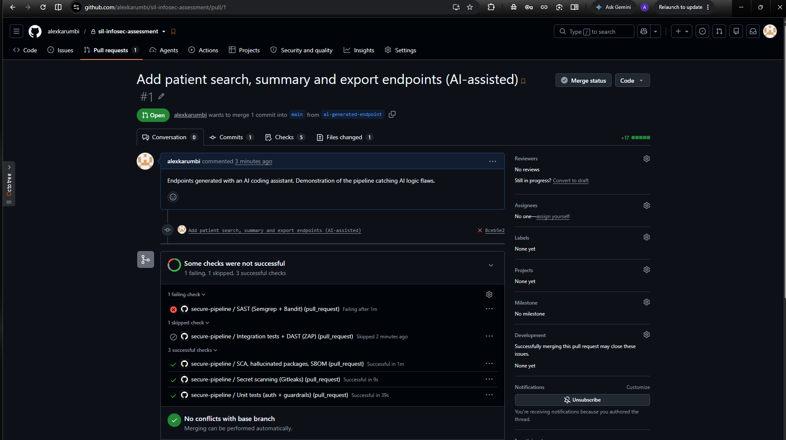

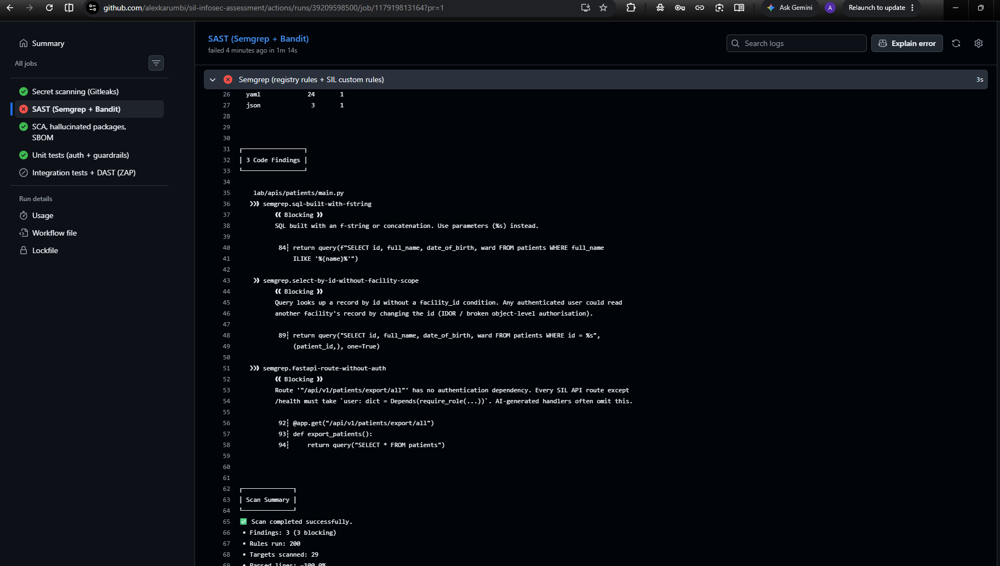

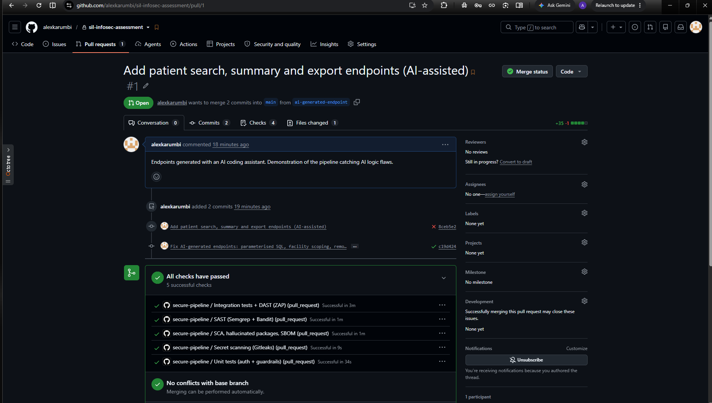

**The takeaway for SIL:** the most valuable rules are the ones written from our own codebase's patterns. Every incident or missed flaw should become a new rule or test, which is the feedback loop at the bottom of the pipeline diagram.
